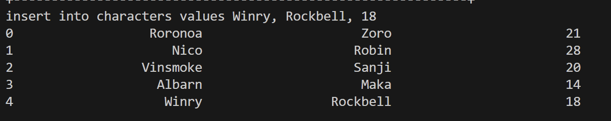
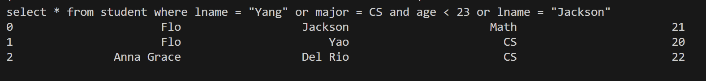
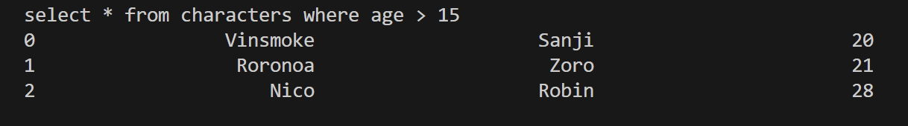
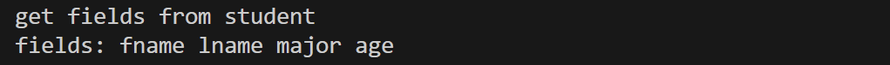
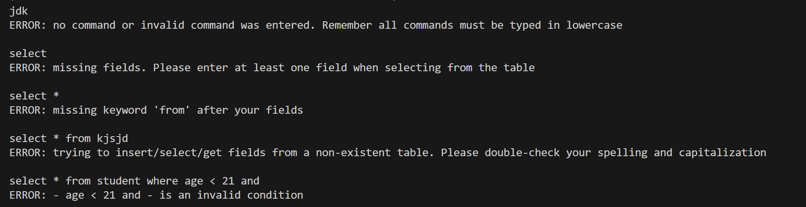
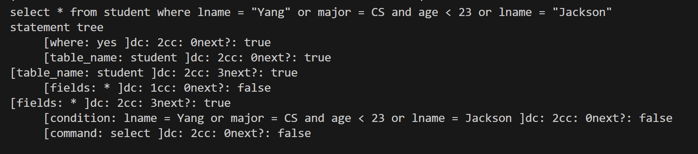
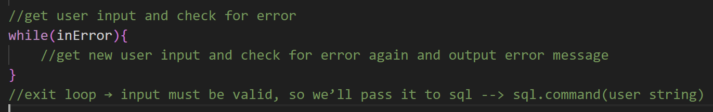

# SQL Database Engine

**A custom SQL-like database engine developed in C++, featuring B+ Tree indexing, binary file storage, state-machine-based SQL parsing, and complex query evaluation using the Shunting Yard algorithm.**

## Overview

SQL Database Engine is a database management system developed from scratch in C++ that supports table creation, record insertion, and data retrieval through SQL-like commands without relying on an existing database engine.

The engine combines a custom database architecture with persistent binary file storage and a finite-state-machine parser for command interpretation. A vector of B+ Tree-backed multimaps provides efficient indexed lookups and range-based queries, while the Shunting Yard algorithm converts complex conditional expressions into postfix notation for subsequent evaluation.

## Key Features

- **SQL-Like Query Processing:** Supports table creation, record insertion, data retrieval, and conditional selection.
- **B+ Tree Indexing:** Uses custom B+ Tree-based maps and multimaps to organize field values and associated record references.
- **Persistent Binary Storage:** Stores table records in binary files for retrieval across program executions.
- **State-Machine-Based SQL Parser:** Tokenizes and parses commands using a finite-state machine.
- **Complex Query Evaluation:** Uses the Shunting Yard algorithm to process relational and logical expressions, including nested conditions.
- **Custom Data Structures:** Implements B+ Trees, maps, multimaps, stacks, queues, and linked-list utilities.
- **Error Handling:** Validates commands and reports invalid SQL syntax or table-related errors.
- **Interactive Console Interface:** Allows users to execute supported database commands and access usage instructions.

---

## Supported SQL Commands

The database engine supports table creation, record insertion, data retrieval, and conditional queries using SQL-like syntax.

| Command | Example | Description |
|---------|---------|-------------|
| `MAKE TABLE` | `make table student fields fname, lname, major, age` | Creates a table with specified fields |
| `INSERT INTO` | `insert into student values Jane, Doe, CS, 24` | Inserts a new record |
| `SELECT *` | `select * from student` | Retrieves all records and columns |
| `SELECT` | `select age, lname from student` | Retrieves specified columns |
| `SELECT WHERE` | `select * from student where age > 21` | Filters records using relational conditions |
| `SELECT WHERE` | `select * from student where (age > 20 and major = CS) or (age < 25 and major = Math)` | Filters records using compound logical and relational conditions |
| `GET FIELDS` | `get fields from student` | Displays a table's field names |

The engine also includes an interactive Help Desk, accessible by entering `?`, which provides command syntax, usage examples, and guidance on supported SQL operations.

# Making/Inserting Into Table Video
https://github.com/barkeshli-CS008-classroom/99_99_final_project-QueencyT/assets/122432408/e6cfb4d3-ba29-487e-9f22-1de80ad202d6

# Selecting From Table Video
https://github.com/barkeshli-CS008-classroom/99_99_final_project-QueencyT/assets/122432408/aa8d1bd7-4af8-4874-93c2-7fa719281c9d

# How This Project Was Built: 
This project uses data structures such as BPlusTrees, MultiMaps, and Maps for their ability to efficiently sort, store, and look-up records. This project also uses stacks, and queues in tandem with RPN and ShuntingYard algorithms in order to evaluate the user’s inputted commands.

# Insert Command: 

# Select Command:

# Get Fields Command: 

# Help Desk:
Picture of Help Desk (which you can get by entering '?')

A Guide to all the Commands (which you can get by entering 'A')
 

https://github.com/barkeshli-CS008-classroom/99_99_final_project-QueencyT/assets/122432408/f1747632-3361-4040-9c20-60962fc57a9e

# Error Checking: 
Sample of some error-checking features

https://github.com/barkeshli-CS008-classroom/99_99_final_project-QueencyT/assets/122432408/79d79651-8a52-4e7c-8555-75733eac81a7

## EXTRA INFO: 
# Technical Details: 
All user inputs are tokenized using my ‘Stokenizer’ class into a vector of strings. Then that vector of strings is passed into my ‘Parser’ class which will parse the user’s input according to a state machine I designed. The ‘Parser’ class includes a map of all this project’s keywords (select,from,where,etc.) along with the column/row number they correspond to in the adjacency matrix. Anything that is not a number is treated as a ‘SYMBOL’ (table names, field names, etc) which my state machine will deal with accordingly. The purpose of the parser class is to create a multimap that stores/organizes the user’s input. I call this multimap the “statement tree”. An example of how this multimap would look like after parsing is this: 

This multimap is later passed into my SQL class which will create a table to display to the user. The table is created according to the commands/conditions etc stored in the multimap/statement tree. 

All data is stored in binary files using the ‘write’ function of my ‘FileRecord’ class and retrieved using the ‘read’ function of my FileRecord class. All data storage and retrieval happens within this project’s Table class which uses read and write to manipulate the binary files. When the table class reads from the binary file, it stores the data into a vector of multimap<string,long>. Each Multimap represents a field (age, fname, lname,etc) and within those multimaps are specific values of that field (the age multimap would have  values like “21" : [vector of recnos], “20” : [vector of recnos], etc). Long is for the record numbers that contain those values. For example, “21” : [10,15,16] means records 10,15, and 16 all have an age of 21.

Storing my data this way allows me to use the iterator functions of my Multimap class ('upper_bound', 'lower_bound', 'begin', and 'end'). The function ‘upper_bound’ and ‘lower_bound’ will return an iterator to the upper and lower bounds of any value you enter while 'end' and 'begin' will return an iterator to the “smallest” value and “largest” value in the Multimap respectively. I use these iterator functions to efficiently select the appropriate values according to the user’s condition. For example, if the user wanted to find all the records with “age > 21”, I would first obtain the upper bound of 21 and then I’d iterate from the upper bound to the end, which would give me all the values greater than 21 along with the record numbers that have those values. I do similar things to evaluate the other relational operators (>,<,etc). 

# Challenges I Faced when Making this Project 

One challenge I faced was when I was designing the ‘Interaction’ and ‘Error_Handler’ classes. When designing them, I wasn't sure whether I should have my Interaction class own an ‘Error_Handler’ object and do all my error checking/correction in my interaction class, so my SQL class only ever receives completely valid commands or to have my SQL class do its own error-checking, meaning I would allow nonsense user input to be passed into SQL. Originally, I thought it would be more intuitive to have my interaction class own an error handler object, so I could have code like this

But doing so meant that even in the best case scenario (user inputs a valid command first try), I would be parsing the user's input twice. Once during the initial check for errors, and then again when I pass the user string into SQL. There were a couple workarounds I could think of to continue error handling in the Interaction class while avoiding the double-parsing problem, but I felt the solutions were a bit clumsy. Ultimately, I decided to go with the second route, having the SQL class do its own error-checking, which avoids the double parsing problem while still being a relatively clean solution. 

  

  

  

  
