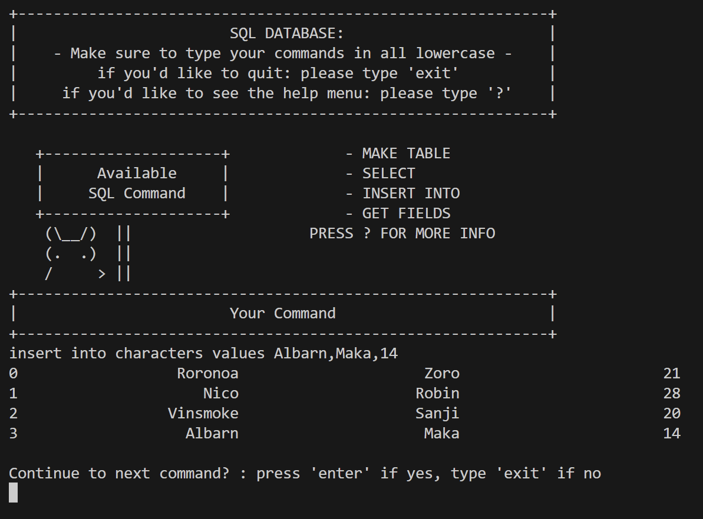
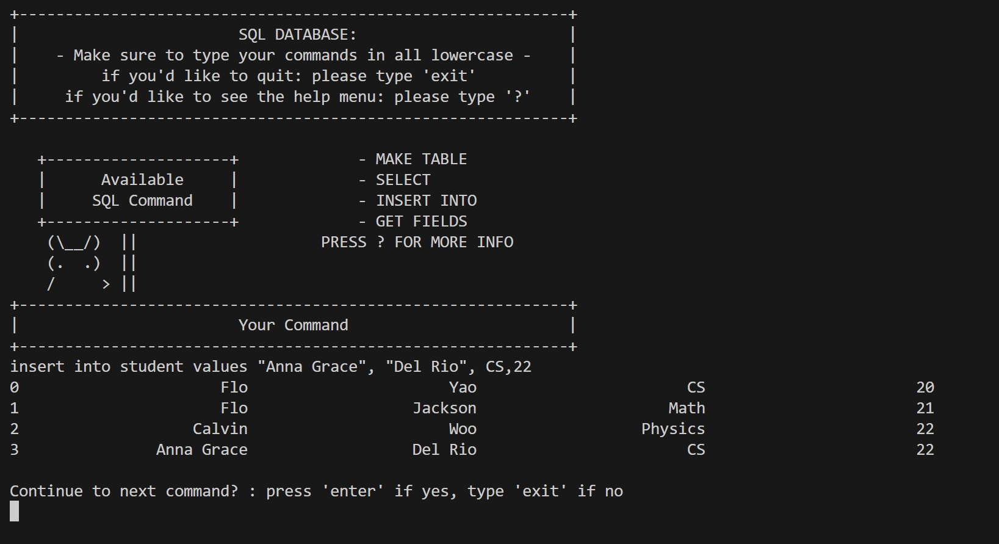
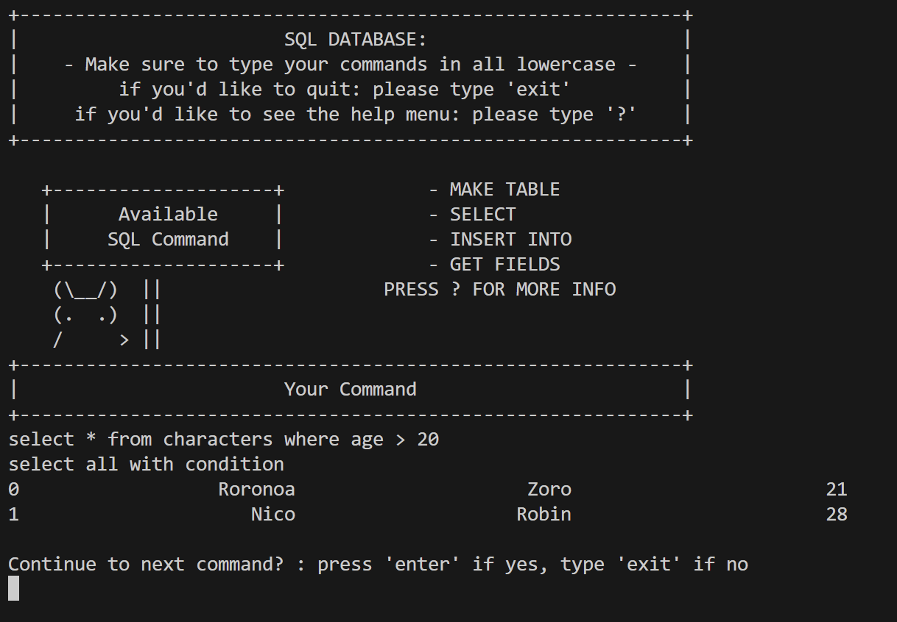
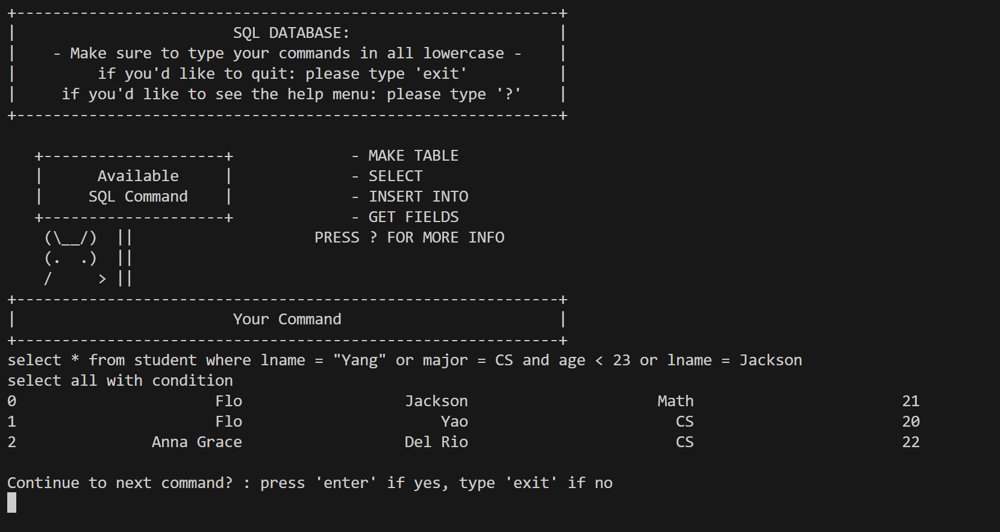
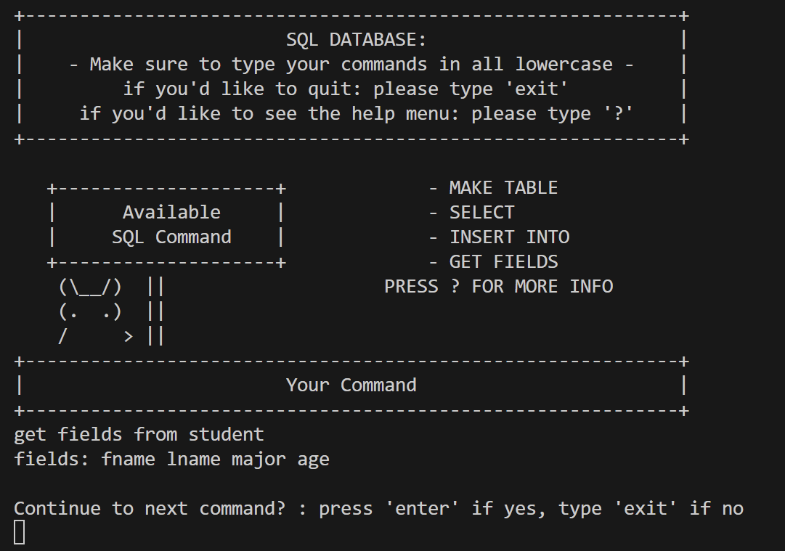
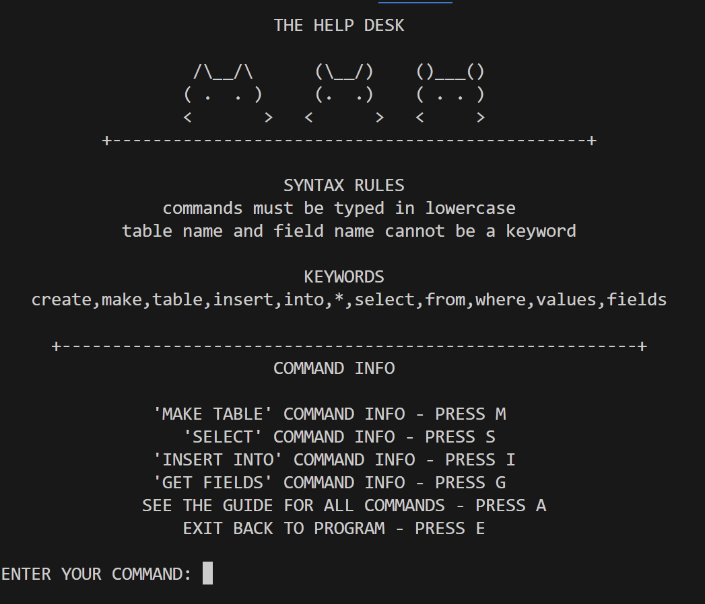
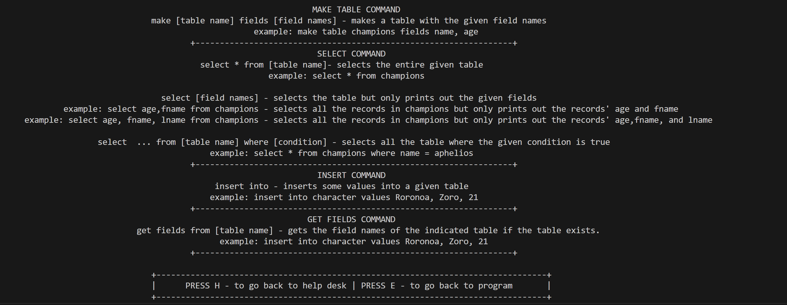
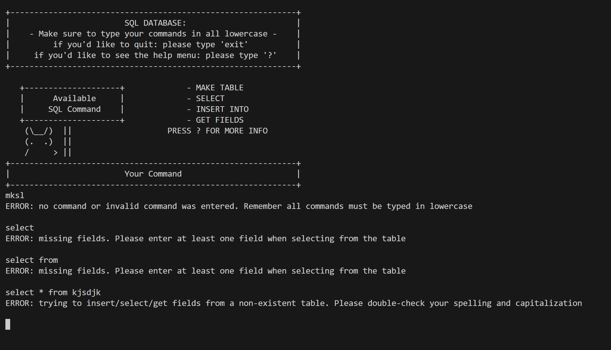

# SQL DATABASE

## Name: <ins> Queency Tan </ins>

## DESCRIPTION:

This project is an SQL Database made from scratch. Users can input SQL commands such as MAKE TABLE, SELECT, and INSERT INTO in order to create and modify their tables. For example, if the user inputted a command such as ‘make table student fields fname, lname, age’ a table with the name student will be created with the fields fname, name, and age. The other commands are equally straightforward. If the user inputted a command such as ‘select * from student where age > 21’, the program will find all your records with an age greater than 21, put it into a table, and display it for you. You can also choose to display only certain fields by inputting a command such as ‘select age,lname from student where age > 21’. This command will retrieve the same values as the previous select command except instead of displaying all the fields, it will display only the ‘age’ and ‘lname’ of the selected records. Lastly, if the user inputted a command such as ‘insert into student values Jane, Doe, 24’, the program will create a new record with those values and insert it into your table.

If after making multiple tables, you forget the field names of a certain table, you can use the ‘GET FIELDS’ command and the program will give you the field names of that given table provided that the table already exists. For example, inputting the command ‘get fields from student’ will get you the field names of the student table you created. 

If you are not familiar with the syntax of SQL commands, there is no need to worry. This project also includes an ‘Error_Handler’ class that will help you troubleshoot any syntax errors you might have. Furthermore, you can always enter '?' in order to see the help menu for explanations and examples of the syntax. 

# How This Project Was Built: 
This project uses data structures such as BPlusTrees, MultiMaps, and Maps for their ability to efficiently sort, store, and look-up records. This project also uses stacks, and queues in tandem with RPN and ShuntingYard algorithms in order to evaluate the user’s inputted commands.

# Insert Command: 

# Select Command:

 

# Get Fields Command: 

# Help Desk:
Picture of Help Desk (which you can get by entering '?')

A Guide to all the Commands (which you can get by entering 'A')
 

# Error Checking: 
Sample of some error-checking features

  

  

  

  
